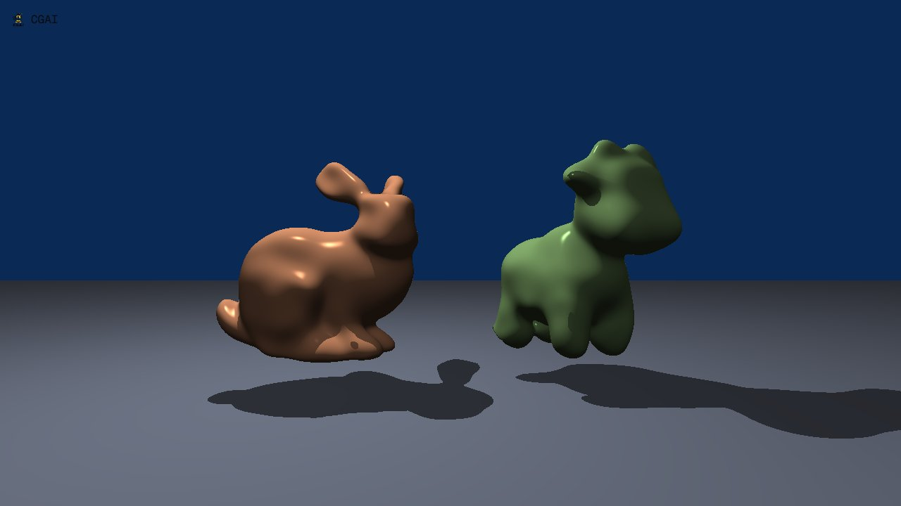
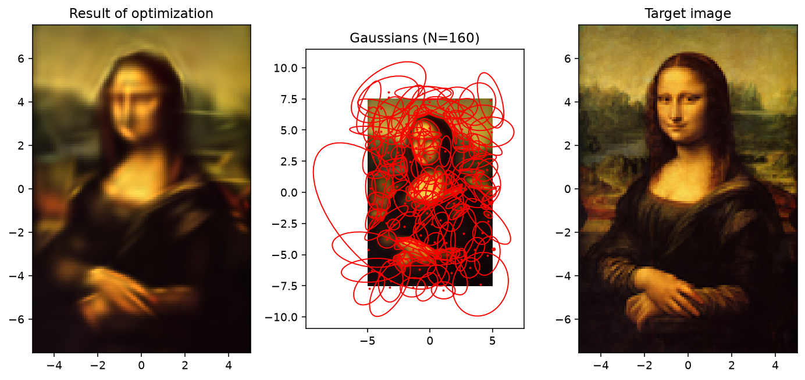
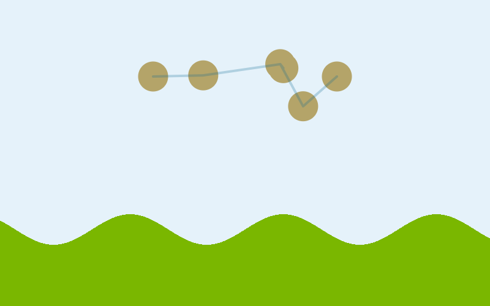
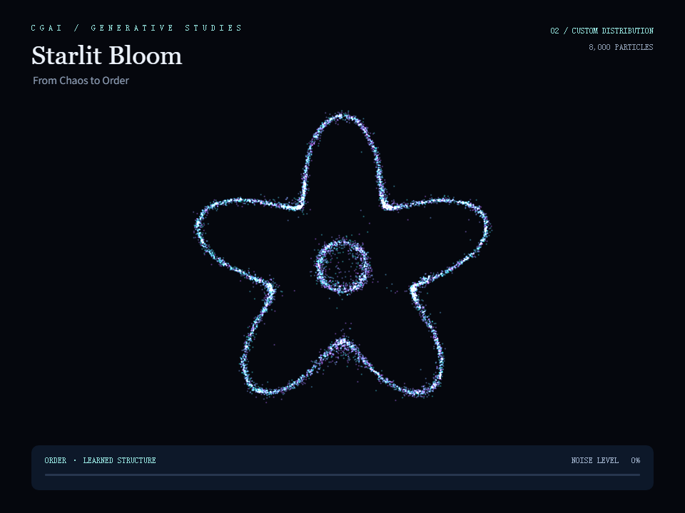

https://human77777.github.io/cgai-results/

## A2a

Default

Sphere, box, and plane distance fields, joined by union, intersection, and subtraction, then ray marched and lit with Phong.

Creative

A small Blue Side Nexus: a cut crystal on stacked rings, with orbiting supports. The parts are smooth distance fields, moved by time.

## A2b

Default

A small sine network stores the bunny and cow as distance fields. The same marcher sets both on a ground plane.

Creative

Mid-Autumn scene. The moon is a sphere, the rabbit is the trained bunny, and a second network is the Poro, with a few primitive features on top.

## A3a

Default

Procedural cloud as an absorption-emission volume. Rays take jittered steps and composite color by transmittance. The clip also passes through the cube, with the same integrator.

Creative

Nebula Eye: a slow rotating ring of mist, two ribbons, and a bright core, accumulated over a thin starfield.

## A3b

Lego

A compact NeRF, two narrow ReLU layers, reconstructs the Lego truck. A held-out view reaches 23.15 dB. The shader runs the exported weights.

Ship

The same volume renderer on the synthetic ship, with a higher-frequency encoding. Held-out PSNR is 27.58 dB. Thin rigging stays slightly soft.

## A4

Synthetic

Forty 2D Gaussians fit the original Spiral Bloom. Left is the render, middle the splats, right the target. The clip is that optimization.

Mona Lisa

One hundred sixty additive Gaussians approximate the Mona Lisa. Smooth splats cannot keep every edge.

Creative

Four hundred Gaussians fit Van Gogh's sunflowers. The clip is the fit over time.

Sunflowers

Final sunflower reconstruction beside the F455 painting. Petals stay softer than the source because each splat is smooth.

## A4 Photo

A photograph fit with 800 Gaussians: the result, the splat field, and the photo. This count is higher than the usual shader budget.

## A5

Default

XPBD rope. Each frame predicts positions, solves springs, a wavy ground, and particle contacts, then rebuilds velocity.

Creative

Newton's cradle. Five hanging bobs pass a released swing through contact. The motion is simulated, not keyframed.

## A6

Bee

Bee points sampled from the source image, next to points drawn by the trained reverse process. Small strokes stay a little soft.

The same bee model in the browser: 8,000 points and a 400-step noise schedule, with the network packed into the shader. The clip forms the shape, then lets it dissolve.

Creative

A separate model learns a five-petal bloom from noise, without pulling points toward stored target positions.

That bloom in the same WebGL viewer, cycling between noise and the flower.
