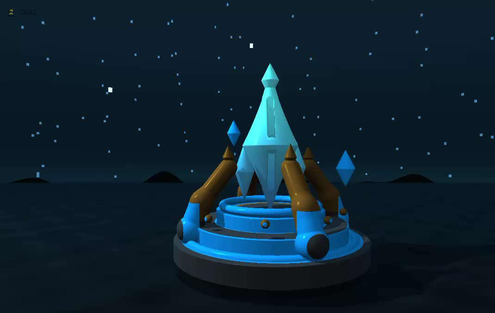
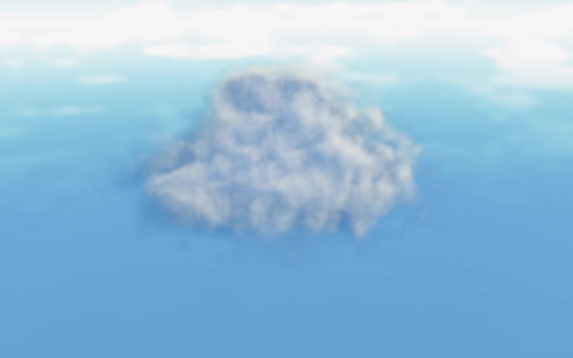
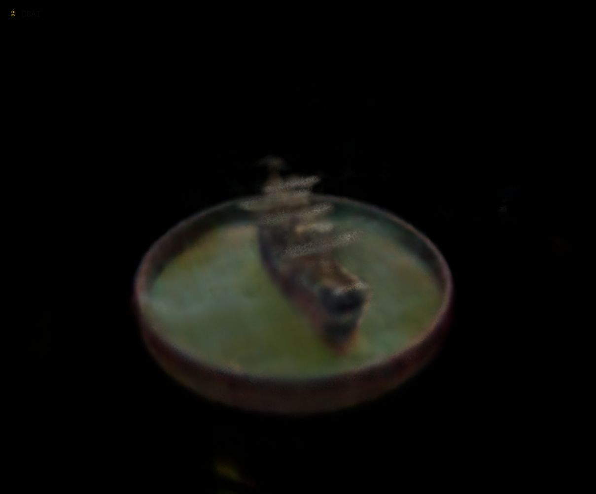
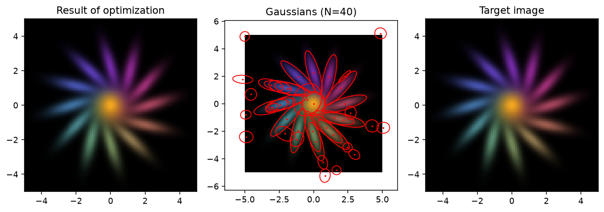
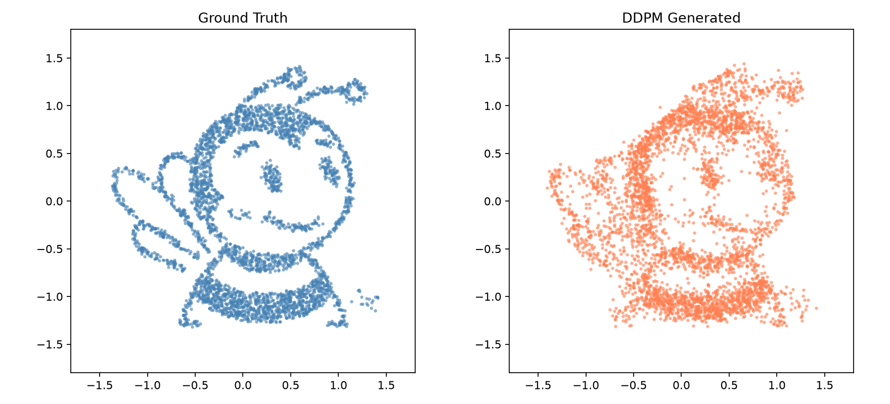

https://human77777.github.io/cgai-results/

## A2a

Default

GLSL. Sphere, plane, and box SDFs combine with min, max, and subtraction. The ray steps by the returned distance, stops near 0.001, and takes a forward-difference normal for Phong shading.

Creative

Same marcher. The nexus is smooth unions of bicones, cylinders, tori, and capsules. iTime moves the crystal and the orbiting supports.

## A2b

Default

PyTorch sine MLP, trained with Adam and MSE on mesh samples, then copied into GLSL. The shader ray-marches the bunny and cow onto a ground plane.

Creative

A second network, width 32, trains on a Poro mesh made from spheres and marching cubes. The moon is a sphere, the rabbit reuses the bunny field, and eyes and paws are small primitive unions.

## A3a

Default

WebGL. Ray-box uses the slab test. 128 jittered samples; opacity is 1 - exp(-sigma dt), and color accumulates as C += T * alpha * rgb. The still is the cloud. The clip also shows the cube with the same integrator.

Creative

Same integrator. Density is a tilted rotating ring, two ribbons, and a Gaussian core, with sigma = 5 * density, drawn over a starfield.

## A3b

Lego

PyTorch NeRF: positional encoding L=6, two 64-unit ReLU layers, 64 stratified samples. Alpha is 1 - exp(-sigma delta); color is the transmittance-weighted sum. Adam runs 10,000 steps. Weights export to GLSL and composite front to back. Held-out PSNR 23.15 dB.

Ship

Same pipeline with encoding L=8 and 20,000 steps. Views are resized to 100x100 and composited on black. Held-out PSNR 27.58 dB. Thin rigging stays slightly soft.

## A4

Synthetic

Differentiable 2D Gaussians in PyTorch. Covariance is R D R^T, and color is an additive quadratic splat. Adam fits 40 splats with L1 loss. Left is the render, middle the splats, right the target. The clip is training.

Mona Lisa

Same optimizer with 160 splats. Colors are clamped per splat, but overlap still adds, so edges stay soft.

Creative

400 splats, learning rate 0.01, on Van Gogh F455. The shader repeats the training covariance and quadratic form. The clip is the fit over time.

Sunflowers

Trained field beside the painting. Smooth kernels blur petals and brush marks.

## A4 Photo

Separate PyTorch fit with 800 Gaussians: result, splat curves, and the photo. The usual shader budget is 100-200; this is the higher-count check.

## A5

Default

GLSL XPBD. Five substeps apply gravity, predict positions, solve constraints, and rebuild velocity. lambda = -C / (sum w||g||^2 + alpha/dt^2). Springs use rest length, contacts separate overlaps, and the ground is a sine height field.

Creative

Five rods and bobs. Contacts run several times per substep and exchange normal velocity, so the swing travels across the row. Nothing is keyframed.

## A6

Bee

PyTorch DDPM. Sinusoidal position features plus time go into a small ReLU net that predicts the added noise; training is MSE and Adam. Points are dark pixels of the bee. Left is the data, right is reverse sampling.

Schedule and weights are packed into GLSL. 8,000 points step the same forward and reverse updates on the GPU. The clip is the canvas forming, then dissolving.

Creative

A second model trains on a five-petal radial distribution. Sampling uses only the noise predictor, not a blend toward stored positions.

Same WebGL particle loop for the bloom model, cycling between noise and the flower.
